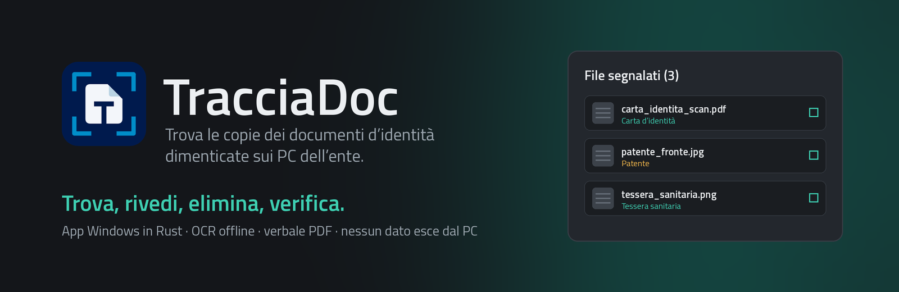
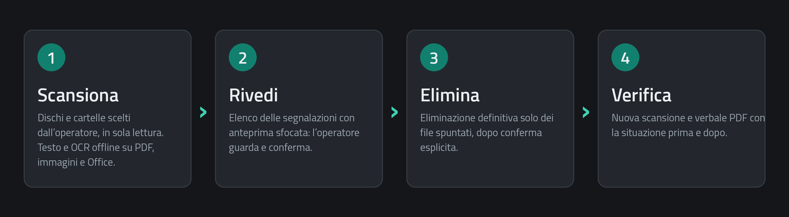
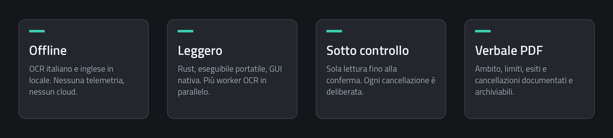

<p align="center">
  
</p>

<p align="center">
  <a href="https://github.com/realfulvio/tracciadoc/releases/latest"><b>Scarica per Windows x64</b></a> ·
  <a href="CHANGELOG.md">Changelog</a> ·
  <a href="docs/ISTRUZIONI.txt">Istruzioni</a> ·
  <a href="docs/VALIDAZIONE.md">Validazione</a>
</p>

## Cos'è

**TracciaDoc** è un'app per Windows 10/11 che cerca sui dischi di un PC le **copie di documenti d'identità** rimaste lì per sbaglio: scansioni, foto e PDF di carta d'identità, passaporto, patente e tessera sanitaria. Quando un ente rilascia documenti o gestisce pratiche, quelle copie finiscono facilmente in Download, Documenti o sul Desktop e ci restano.

Con TracciaDoc l'operatore le trova, le guarda, le elimina e produce un **verbale PDF** che documenta cosa è stato controllato e cosa è stato rimosso.

Tutto avviene **in locale**: niente cloud, niente telemetria, nessun file lascia il computer.

<p align="center">
  
</p>

## A cosa serve

- **Verifiche periodiche** delle postazioni che trattano documenti d'identità, ad esempio quelle per il rilascio della CIE.
- **Pulizia guidata**: l'elenco delle segnalazioni, con anteprima sfocata, si controlla a occhio prima di cancellare qualsiasi cosa.
- **Prova documentata**: il verbale riporta ambito, esiti, limiti, eliminazioni e la ri-scansione finale.

Le fototessere e i semplici dati anagrafici sparsi nei file (un nome, un codice fiscale) non sono l'obiettivo e non vengono segnalati da soli.

<p align="center">
  
</p>

## Come funziona

1. **Scansiona.** Scegli dischi e cartelle: la ricerca è in sola lettura. PDF (anche scansionati), immagini e documenti Office/OpenDocument, compresi i vecchi Word `.doc`, vengono letti per firma, anche con estensione errata, ed esaminati con testo e **OCR offline italiano e inglese**.
2. **Rivedi.** Ogni segnalazione mostra tipo di documento, formato, percorso e motivo, con miniatura sfocata che si schiarisce al passaggio del mouse. Si apre il file o la cartella e si decide.
3. **Elimina.** Si spuntano i file da togliere e si conferma. L'eliminazione è definitiva (niente cestino) e riguarda solo file regolari locali; se un file cambia dopo l'analisi non viene toccato.
4. **Verifica.** TracciaDoc ripete la scansione sugli stessi percorsi e genera il verbale PDF con la situazione prima e dopo.

L'esito **«nessun documento rilevato»** compare solo a copertura completa: errori, accessi negati e limiti raggiunti sono dichiarati e rendono la verifica incompleta.

## Sotto il cofano

- **Rust**, eseguibile portatile con GUI nativa (egui) su DirectX 12; con PC senza driver video usa l'adattatore software WARP, con OpenGL come ripiego. Nessuna installazione, nessun Python, nessun Internet.
- **OCR Tesseract 5 offline** e PDFium incorporati. Più worker in parallelo (default: core fisici − 1), ognuno in un processo separato con Windows Job, limite di memoria e timeout.
- **Prefiltro** che scarta le immagini senza zone di testo e **orientamento automatico** delle scansioni ruotate: l'OCR lavora solo dove serve.
- **AVX2/SSE** scelti a runtime con ripiego su CPU generica. L'uso di GPU/iGPU/NPU è valutato solo se un benchmark dimostra un vantaggio reale.
- Nessuna cache persistente. Lo storico `audit.jsonl` contiene solo eventi e conteggi, mai percorsi o contenuti.

I dettagli sulle prestazioni misurate, il corpus di prova e i metodi di misura sono in [docs/VALIDAZIONE.md](docs/VALIDAZIONE.md); componenti e licenze in [docs/COMPONENTI.md](docs/COMPONENTI.md).

## Provarlo in due minuti

1. Scarica lo ZIP dall'ultima [release](https://github.com/realfulvio/tracciadoc/releases/latest) ed **estrai tutta la cartella** (l'EXE deve restare accanto a `runtime` e agli altri file).
2. Avvia `TracciaDoc.exe` e premi **Carica prove sintetiche**: il pacchetto include facsimili inventati, anche volutamente problematici, quindi su quel corpus un esito incompleto è normale.
3. Per una verifica vera scegli i dischi o le cartelle; per leggere i profili di altri utenti possono servire privilegi amministrativi.

La verifica del download è nel file `SHA256SUMS.txt` della release. L'EXE non è firmato.

## Cosa non fa

TracciaDoc è uno strumento di aiuto, non una garanzia.

- Il riconoscimento è euristico: possibili falsi positivi e falsi negativi. Le segnalazioni vanno viste da una persona.
- Il verbale documenta l'ambito effettivamente controllato e **non certifica l'assenza assoluta** di documenti, né implica l'approvazione di terzi.
- Non sono letti: HEIC/HEIF, XLS e PPT legacy, archivi generici, file cifrati, oggetti OLE e macro (quelli con estensione moderna rendono la verifica incompleta). GIF e TIFF solo la prima immagine.
- Il parser gira con i privilegi dell'operatore: processo separato e Windows Job non sono una sandbox di sicurezza. Non c'è uno snapshot coerente dell'intero disco.
- Il PDF può contenere percorsi e giudizi manuali: va conservato in una cartella riservata, oppure si omettono i percorsi in esportazione.

## Compilare dai sorgenti

Servono solo allo sviluppatore: Rust stabile ≥ 1.95 (x64 MSVC), Visual Studio Build Tools con SDK Windows, PowerShell 7 e Python 3.11+.

```powershell
python -m venv scratch/tooling
& .\scratch\tooling\Scripts\python.exe -m pip install -r scripts/requirements-build.txt
pwsh -NoProfile -File scripts/prepare_runtime.ps1
& .\scratch\tooling\Scripts\python.exe scripts/make_fixtures.py
cargo test --release --locked
cargo clippy --all-targets --locked -- -D warnings
cargo build --release --locked
& .\scratch\tooling\Scripts\python.exe scripts/package.py
& .\scratch\tooling\Scripts\python.exe scripts/validate.py
& .\scratch\tooling\Scripts\python.exe scripts/edge_tests.py
```

L'uscita è in `dist/TracciaDoc/`. Il manifesto del runtime MSYS2 è bloccato in [docs/runtime-lock.json](docs/runtime-lock.json); PDFium e modelli OCR sono verificati con SHA256.

Scansione da riga di comando, solo con percorso assoluto esplicito:

```powershell
.\dist\TracciaDoc\TracciaDoc.exe --scan '<CARTELLA_LOCALE>' '<VERBALE_NUOVO.pdf>'
```

Opzioni: `--cpu`, `--omit-paths`, `--max-mb`, `--max-pages`, `--max-files`, `--timeout-secs`, `--memory-mb`, `--workers`, `--no-prefilter`. `--demo` marca gli output sintetici; un output già esistente non viene sovrascritto.

Test e benchmark usano **solo il corpus sintetico** in `fixtures/`: facsimili inventati, nessun documento reale.

## Licenze

Sorgenti propri sotto [licenza MIT](LICENSE). Dipendenze, font e modelli OCR mantengono le rispettive licenze, incluse nel pacchetto. Il marchio **realhcok** è dell'autore del progetto; lo stemma comunale incluso nell'app è citato con la sua fonte in [assets/ui/FONTI-E-LICENZE.md](assets/ui/FONTI-E-LICENZE.md) e **non** è coperto dalla licenza MIT.

---

<p align="center"><sub>TracciaDoc · powered by <b>real&gt;hcok_</b></sub></p>
