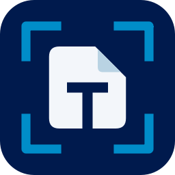

<p align="center">
  
</p>

# TracciaDoc

MVP Windows x64 in Rust per trovare possibili copie di documenti d'identita nei file locali e produrre un verbale PDF. Repository **privato**, sorgenti MIT. Nessuna scansione automatica, telemetria o elaborazione cloud.

**[Scarica TracciaDoc 0.1.0 per Windows x64](https://github.com/realfulvio/tracciadoc/releases/download/v0.1.0/TracciaDoc-0.1.0-windows-x64.zip)** · [Release e checksum](https://github.com/realfulvio/tracciadoc/releases/tag/v0.1.0) · [Changelog](CHANGELOG.md)

## Avvio rapido

1. Scarica lo ZIP della release ed **estrai tutta la cartella**. L'EXE deve rimanere insieme a `runtime`, licenze e file del pacchetto.
2. Apri `TracciaDoc.exe`, scegli dischi/cartelle e compila operatore e riferimento. Per accedere ai profili degli altri utenti possono servire privilegi amministrativi.
3. Premi **Avvia verifica**, controlla le segnalazioni e confermale o scartale manualmente.
4. Genera il verbale PDF; puoi omettere i percorsi completi dall'esportazione.

Per provare il funzionamento usa **Carica prove sintetiche**. I facsimili inclusi contengono anche file volutamente problematici: un esito incompleto su quel corpus è previsto.

La macchina destinataria non richiede Rust, Python, SDK, Internet o un'installazione di Tesseract. La GUI usa DirectX 12 (Windows 10/11), anche senza driver video del produttore tramite l'adattatore software WARP; OpenGL 3.3 resta come ripiego automatico; il collaudo documentato riguarda Windows 11. L'EXE non è firmato Authenticode.

## Funzioni principali

- Una sola ricerca completa supportata, con **OCR offline ita+eng**.
- Possibili **carte d'identità, passaporti, patenti e tessere sanitarie**, con tipo di documento e formato del file.
- **Percorso completo**, **Apri file** e **Mostra nella cartella**; le estensioni ambigue non vengono eseguite dall'app.
- Conferma o scarto manuale, distinto dal riconoscimento automatico e riportato nel PDF.
- Controllo in sola lettura, limiti espliciti e interruzione senza perdere gli esiti raccolti.
- Tema dark blu notte/petrolio, Titillium Web e firma originale **realhcok**.

## Uso

Aprire il pacchetto portatile, selezionare dischi/cartelle, compilare operatore e riferimento, premere **Avvia verifica**. Viene eseguita una sola ricerca completa fra le capacita supportate, con OCR locale. Il footer mantiene accessibili avvio/interruzione e la scala UI.

L'esito mostra se sono state trovate possibili copie, quanti file, quali tipi (carta d'identita, passaporto, patente, tessera sanitaria) e quali formati. Ogni segnalazione mostra percorso completo, motivo, **Apri file**, **Mostra nella cartella** e stato della verifica manuale. Il PDF distingue l'analisi automatica da conferme/scarti dell'operatore. I percorsi sono inclusi per impostazione iniziale e si possono omettere.

**Nessun documento rilevato nell'ambito esaminato** e **verifica incompleta/interrotta** sono esiti distinti. Rilevamenti e incompletezza possono coesistere. Il verbale non certifica l'assenza assoluta e non implica approvazione Lepida.

## Implementazione

- egui/eframe 0.37, font Titillium Web e asset del kit incorporati, palette blu notte/petrolio, firma originale realhcok, icona PE e finestra.
- Enumerazione streaming, nessuna esclusione automatica di AppData/cestino/profili. Scelta di dischi, cartelle e volumi senza lettera; rete esclusa e rimovibili solo su selezione esplicita. Junction e collegamenti discendenti non attraversati, volumi montati da selezionare separatamente.
- Lettura per firma, anche con estensione errata/assente; PDFium per PDF, XML/ZIP con decompressione limitata per Office, decoder immagini limitati e Tesseract 5.5.3 ita+eng. Nei PDF viene eseguito OCR anche sulle pagine che contengono testo digitale.
- N parser persistenti in parallelo (default core fisici - 1), ognuno processo separato con un thread OCR e il proprio Windows Job con memoria limitata, timeout/annullamento e recupero. Non e una sandbox di sicurezza e mantiene i privilegi dell'operatore.
- Prefiltro prima dell'OCR: immagini e pagine senza zone con tratti a contrasto tipo testo non vanno all'OCR e sono dichiarate nel verbale; l'OCR gira sulla sola zona con testo. Orientamento con OSD di Tesseract quando e affidabile, altrimenti 4 rotazioni.
- CPU x64 di base, CRT statica. Automatico: AVX2/SSE solo dopo rilevamento runtime Rust e conferma della scelta Tesseract. Solo CPU: prodotto scalare generic per confronto, stesse regole. AVX-512/GPU/NPU non implementate. Nessun target-cpu=native globale.
- Nessuna cache persistente. I duplicati vengono rianalizzati conservando i percorsi. Audit JSONL limitato a eventi/conteggi, senza documenti, testo OCR o percorsi.

Formati e limiti esatti: [istruzioni](docs/ISTRUZIONI.txt). Componenti, licenze e valutazione acceleratori: [componenti](docs/COMPONENTI.md). Prove e misure: [validazione](docs/VALIDAZIONE.md).

## Collaudo e prestazioni documentate

- 6 test Rust e Clippy passati, build release nativa Windows.
- Corpus sintetico di **37 file**: 27 positivi analizzabili rilevati, 6 negativi senza segnalazioni e 4 casi con limiti. Fra questi ultimi c'è un ulteriore positivo cifrato non analizzato: **27 rilevati su 28 positivi noti complessivi**.
- Stesse motivazioni sui percorsi generico e AVX2; fixture invariate dopo i controlli.
- Prove interattive Windows di selezione, avanzamento, interruzione, apertura file/cartella, controllo manuale, PDF e scala dell'interfaccia.
- Circa **11,85 secondi di motore** sul corpus, contro 12,78 con percorso generico; circa 158 MiB di picco working set del worker e pacchetto di circa 63,5 MiB non compresso. Hardware di prova: Ryzen 7 PRO 5750G, 32 GB RAM, SSD NVMe.

- 0.2.0 sulla VM Windows di test (4 vCPU, nessuna GPU reale, 3 worker): 296 file sintetici in 44,8 s invece di 96,2 s con gli stessi 216 rilevamenti; 8 foto senza testo in 0,5 s invece di 203 s (scartate dal prefiltro e dichiarate). Corpus di validazione a 41 file: 29 positivi analizzabili rilevati, nessun falso negativo o positivo. Dettagli in [docs/VALIDAZIONE.md](docs/VALIDAZIONE.md).

Sono risultati del collaudo di sviluppo su un corpus piccolo e sintetico, non stime statistiche di accuratezza su documenti reali o promesse su altri PC. Metodi di misura, cache e limiti sono descritti in [docs/VALIDAZIONE.md](docs/VALIDAZIONE.md).

## Limiti da conoscere

AVX-512, GPU e NPU non sono implementate. GIF/TIFF sono limitati alla prima immagine; legacy DOC/XLS/PPT, archivi generici, cifrati, OLE/macro e risorse esterne non vengono analizzati. Errori, accessi negati e limiti raggiunti devono restare visibili come copertura incompleta.

Il parser mantiene i privilegi dell'operatore: processo separato e Windows Job **non sono una sandbox di sicurezza**. Non c'è uno snapshot coerente dell'intero disco. L'esito non garantisce l'assenza di documenti né un'approvazione o accettazione di Lepida.

I contenuti riconosciuti restano in memoria. I percorsi e i giudizi manuali possono invece comparire nel PDF: conservarlo in una cartella riservata e omettere i percorsi quando non necessari. Lo storico essenziale è `%LOCALAPPDATA%\TracciaDoc\audit.jsonl`, con eventi/conteggi senza percorsi o contenuti. Dettagli di conservazione e rimozione nelle [istruzioni](docs/ISTRUZIONI.txt).

## Specifiche e continuita

[docs/PROMPT.md](docs/PROMPT.md) conserva la specifica iniziale. Le richieste successive del 28 ottobre 2026 la aggiornano: una sola ricerca completa, integrazione del kit UI, percorsi e apertura dei file, verifica manuale e risultato esplicito in GUI/PDF. Il campo interno deep resta per rappresentare correttamente eventuali vecchi record preliminari; ogni nuova scansione lo imposta a true e la vecchia opzione CLI --quick viene rifiutata.

Il precedente MVP Python e stato consultato come riferimento per requisiti/test ed e rimasto separato e intatto. Nessun documento, database o report precedente e stato copiato qui.

## Build nativa Windows

Richiesti solo allo sviluppatore: Rust stabile >=1.95 per x64 MSVC, Visual Studio Build Tools con SDK Windows, PowerShell 7, Python 3.11+. La macchina destinataria usa esclusivamente il pacchetto portatile, senza strumenti di sviluppo o Internet. Preparazione delle dipendenze solo prima della distribuzione:

```powershell
python -m venv scratch/tooling
& .\scratch\tooling\Scripts\python.exe -m pip install -r scripts/requirements-build.txt
pwsh -NoProfile -File scripts/prepare_runtime.ps1
& .\scratch\tooling\Scripts\python.exe scripts/make_fixtures.py
cargo test --release --locked
cargo clippy --all-targets --locked -- -D warnings
cargo build --release --locked
& .\scratch\tooling\Scripts\python.exe scripts/package.py
& .\scratch\tooling\Scripts\python.exe scripts/validate.py
& .\scratch\tooling\Scripts\python.exe scripts/edge_tests.py
```

Output dist/TracciaDoc/TracciaDoc.exe, runtime, licenze e prove sintetiche. Il manifesto MSYS2 e bloccato in [runtime-lock.json](docs/runtime-lock.json); PDFium e modelli sono verificati con SHA256 nello script. Gli hash attestano integrita, non sono firme digitali. Il programma distribuito non e ancora firmato Authenticode: `scripts/sign.ps1` lo firma con un certificato di firma codice indicato da `TRACCIADOC_SIGN_THUMBPRINT` oppure `TRACCIADOC_SIGN_PFX`/`TRACCIADOC_SIGN_PFX_PASSWORD` (marca temporale con `TRACCIADOC_SIGN_TIMESTAMP`); nessun certificato nel repository. Serve un certificato rilasciato da una CA attendibile.

CLI facoltativa, scansione solo con percorso assoluto esplicito:

```powershell
.\dist\TracciaDoc\TracciaDoc.exe --scan '<CARTELLA_LOCALE>' '<VERBALE_NUOVO.pdf>'
```

Opzioni: --cpu, --omit-paths, --max-mb, --max-pages, --max-files, --timeout-secs, --memory-mb. --demo marca output sintetici. L'output preesistente non viene sovrascritto. --worker e il protocollo interno, non un'altra modalita utente.

I test e i benchmark usano soltanto il corpus sintetico; nessuna scansione dei dati reali e autorizzata dallo sviluppo.

## Licenze e attribuzione

Sorgenti propri [MIT](LICENSE). Dipendenze, font e modelli mantengono le rispettive licenze, incluse nel pacchetto. Il marchio **realhcok** è fornito dal proprietario per questo uso, senza autorizzazione generale a terzi sul marchio. Il progetto e le release restano privati e accessibili agli utenti autorizzati del repository.
